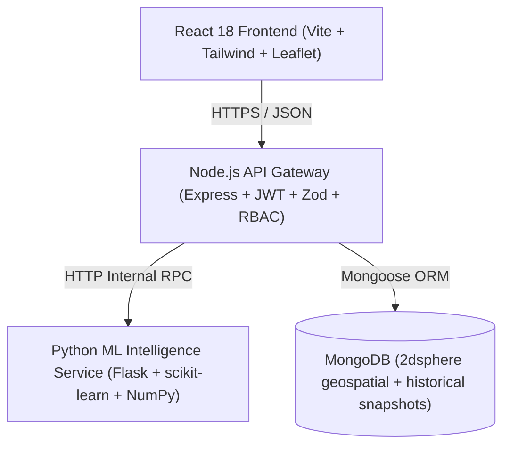

# GramCraft Architecture & System Design

GramCraft is an enterprise-grade, data-driven rural development planning platform designed for District and Block Planning Cells across India.

## System Workflow
1. **Raw Village Metrics & Census Ingestion**: Panchayat data-entry officers input village indicators or upload bulk CSV/Excel and GeoJSON boundary files via Data Hub.
2. **GIS Mapping & Spatial Analysis**: OpenStreetMap and Leaflet render village points sized by population and colored by development tier, overlaid with schools, health centers, and water sources.
3. **AI Recommendations**: Transparent rule-based explanations show the exact numbers and thresholds (e.g. Critical <35%, Priority <50%, Watch <65%) with confidence and action plans.
4. **Predictive Forecasting**: Ridge regression and weighted moving average forecast next-quarter sector trajectories with prediction intervals.
5. **Greedy Budget Optimizer**: Allocates total block capital across villages and sectors via diminishing marginal returns ($\alpha = 0.55$).
6. **Scenario Simulator**: Planners test "what-if" capital injections before issuing tender DPRs.
7. **Execution & Gamified Monitoring**: Verified project completions reward planner XP, trigger celebrations, and update scores via reviewed change requests.

## Component Responsibilities

### 1. Frontend (`/frontend`)
- **Framework**: React 18 with Vite, React Router v6.
- **Styling & Design System**: Tailwind CSS with GramCraft custom palette (Field green `#162922`, Panel green `#1e3b30`, Paper cream `#F6F1E4`, Turmeric accent `#C4832A`, Soft green `#7BAE7F`, Clay `#9E3A34`, Teal `#2E5A63`).
- **State Management**: TanStack React Query for cached server state; Zustand for theme, authentication, and planning room selection.
- **Mapping**: Leaflet with react-leaflet, OpenStreetMap CartoDB tiles, custom GeoJSON choropleth layers, and GPS "Use My Location".
- **Charts**: Chart.js (Radar, Line) and D3 SVG sparklines.
- **Accessibility & Internationalization**: WCAG AA contrast, keyboard navigation (Ctrl+K Command Palette), English and Hindi (Devanagari).

### 2. API Gateway (`/api-gateway`)
- **Runtime**: Node.js 20+ with Express.
- **Authentication**: JWT access token (15m) + rotating refresh token in `httpOnly` secure cookies.
- **RBAC & Scope Middleware**: Enforces roles (`admin`, `district_officer`, `block_planner`, `village_officer`, `viewer`) and strict geographic boundary scopes on every mutating route.
- **Data Validation**: Strict Zod schemas on every request body.
- **Reports**: Direct streaming PDF dossier generation using PDFKit.
- **Audit Logging**: Immutable ledger of all score modifications and administrative actions.

### 3. ML Intelligence Service (`/ml-service`)
- **Runtime**: Python 3.11+ with Flask, scikit-learn, and NumPy.
- **Modules**:
  - `scoring.py`: Computes weighted composite Village Development Score, tier, and XP progress.
  - `recommend.py`: Ranked priority recommendations with numbers, thresholds, and confidence values.
  - `forecast.py`: Closed-form Ridge regression and moving average trend forecasting with prediction intervals.
  - `optimize.py`: Marginal-gain greedy budget allocation with concave diminishing returns curves.
  - `peers.py`: Vectorized Euclidean distance nearest-neighbor peer village matching.
  - `anomaly.py`: Flags suspicious sudden jumps and multi-sector shifts requiring evidence.
