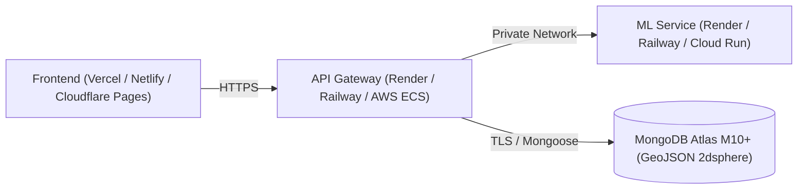

# GramCraft Production Deployment & Scaling Guide

This guide details how to deploy GramCraft across cloud providers, from free/developer tiers to high-availability government cloud environments.

## Architecture Target Topology



---

## 1. Database: MongoDB Atlas Setup
1. Create a free M0 or production M10+ cluster on [MongoDB Atlas](https://www.mongodb.com/atlas).
2. Create a database user (e.g. `gramcraft_admin`) with readWrite permissions.
3. In **Network Access**, add the IP addresses of your backend services (or `0.0.0.0/0` with strong password authentication).
4. Copy the connection string:
   ```
   mongodb+srv://gramcraft_admin:<password>@cluster0.abcde.mongodb.net/gramcraft?retryWrites=true&w=majority
   ```
5. Ensure 2dsphere indexes are built:
   ```javascript
   db.villages.createIndex({ location: "2dsphere" })
   db.facilities.createIndex({ location: "2dsphere" })
   ```

---

## 2. ML Intelligence Service (Render / Railway / Google Cloud Run)
- **Runtime**: Python 3.11 Docker container or Native Python.
- **Port**: 5001
- **Build Command**: `pip install -r requirements.txt`
- **Start Command**: `gunicorn --bind 0.0.0.0:5001 --workers 2 "app:create_app()"`
- **Environment Variables**:
  - `PORT=5001`
  - `FLASK_ENV=production`
  - `CORS_ORIGIN=https://your-api-gateway.onrender.com,https://your-frontend.vercel.app`

---

## 3. Node API Gateway (Render / Railway / AWS App Runner)
- **Runtime**: Node.js 20+
- **Port**: 5000
- **Build Command**: `npm ci --only=production`
- **Start Command**: `npm start`
- **Environment Variables**:
  - `NODE_ENV=production`
  - `PORT=5000`
  - `MONGODB_URI=mongodb+srv://...`
  - `ML_SERVICE_URL=https://your-ml-service.onrender.com`
  - `JWT_SECRET=super_random_64_char_key_here`
  - `JWT_REFRESH_SECRET=another_super_random_64_char_key`
  - `CLIENT_URL=https://your-frontend.vercel.app`

---

## 4. Frontend Application (Vercel / Netlify)
- **Framework Preset**: Vite
- **Root Directory**: `frontend`
- **Build Command**: `npm run build`
- **Output Directory**: `dist`
- **Environment Variables**:
  - `VITE_API_BASE_URL=https://your-api-gateway.onrender.com`

---

## 5. Enterprise & Government Cloud Scale-Up Path (AWS / Azure / GCP)
For state or central government deployments under the National Informatics Centre (NIC) or MeghRaj Cloud:
- **Compute**: Deploy containerized microservices to Kubernetes (EKS / AKS / GKE) using the provided `Dockerfile` specifications.
- **Ingress & TLS**: Configure NGINX Ingress Controller with Let's Encrypt or NIC DigiCert TLS certificates.
- **Caching & CDN**: Mount Redis cluster for rapid caching of district GeoJSON boundaries and public scoreboard leaderboards.
- **Storage**: Configure AWS S3 or MinIO for photo and DPR evidence document attachments.
